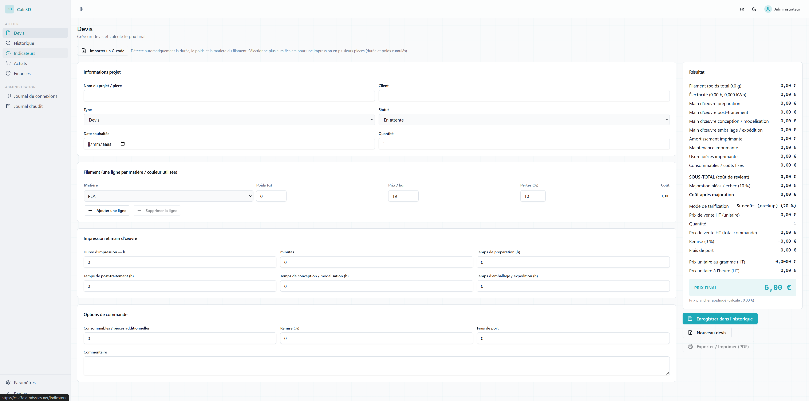
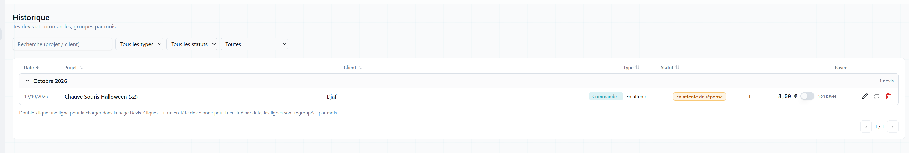
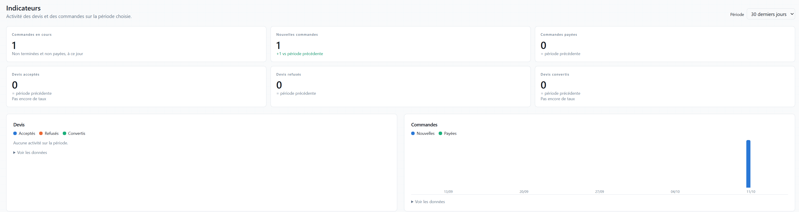
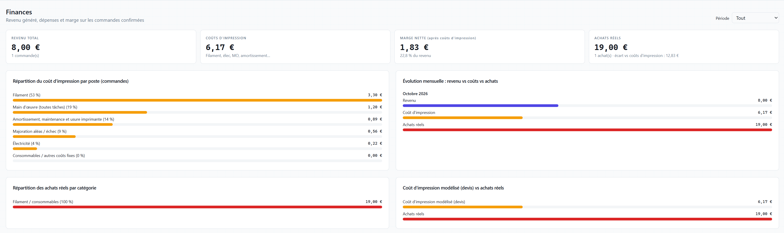
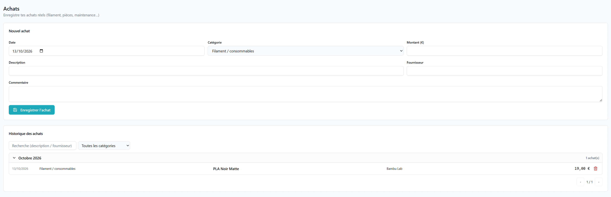
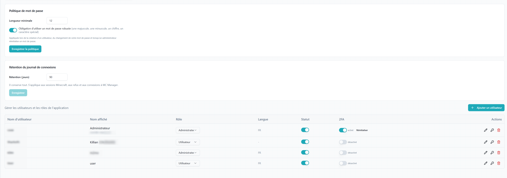
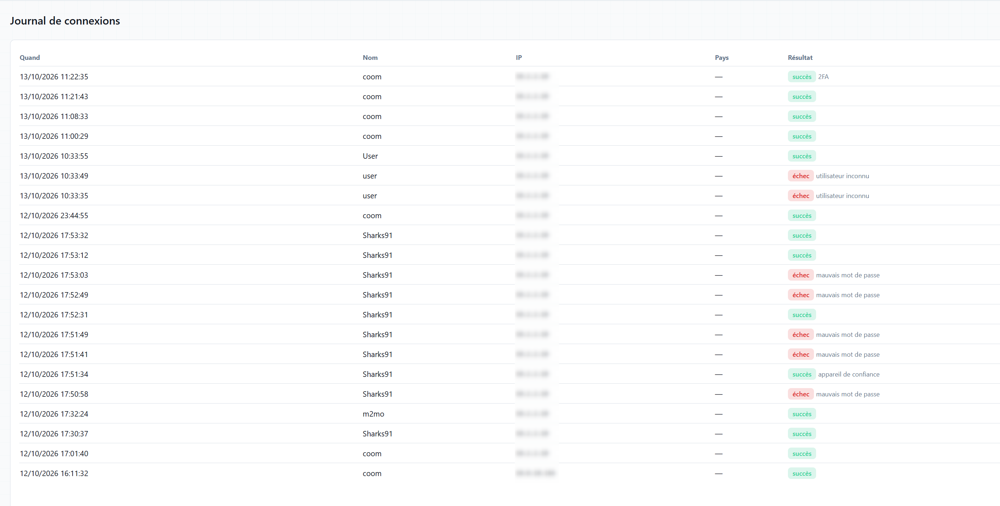

# Calc3D-Web

🇫🇷 [Version française](README.fr.md)

Multi-user web port of [CalculateurPrix](../CalculateurPrix), the 3D printing price calculator (PowerShell / WPF desktop app). The architecture comes from MC Manager and TS6 Manager: pnpm monorepo, Express + Prisma/SQLite backend, React / Vite / Tailwind / shadcn frontend, JWT authentication, Docker Compose.


## Features (lot 1)

- **Accounts and roles**: `admin` manages accounts, the password policy, the login journal and the audit log; `user` owns their own data. An admin is also a user: they **never** see another account's quotes, purchases, settings or catalog.
- **Security** inherited from MC Manager: TOTP MFA with recovery codes, trusted devices, password policy, forced password change.
- **Per-user pricing settings**: electricity, hourly rates (preparation, post-processing, design, packaging), markup or target-margin mode, contingency, VAT, depreciation, maintenance, wear parts, floor price, round-to-euro, cost breakdown on the PDF.
- **Per-user material catalog** (price per kg).
- **Quote page**: multi-material filament, four labor tasks, order options, result recomputed live on every keystroke by the shared engine, save with a snapshot of the settings. The price is **identical to the cent** to the desktop app with the same settings (see [How the price is calculated](../CalculateurPrix/README.en.md#how-the-price-is-calculated)).

- **History** (lot 2): quotes and orders grouped by month, search and filters, reload a quote with the settings it was created with and update it without duplicates, recompute with current settings on demand, convert to order, delete.
- **Purchases** (lot 2): register of actual purchases by category, grouped by month.
- **Finances** (lot 2): revenue, printing costs, net margin and actual purchases over the chosen period; breakdown by item, monthly trend, purchases by category, modeled cost vs actual purchases. Only quotes converted to orders count as revenue.

- **G-code import** (lot 3): on the Quote page, pick one or more G-code files (PrusaSlicer, OrcaSlicer, Bambu Studio, Cura): print time and filament weight are filled in, added up per material across files; an unknown material is added to the catalog at 20 per kg. Files are read in the browser and never uploaded.
- **Print / PDF** (lot 3): after saving, the Export button opens `/quotes/<id>/print`, a printable page with the same sections as the desktop PDF (customer, item breakdown, cost price breakdown if the option is enabled, pricing, final price). Pricing mode and margin are never shown. Amounts are the saved ones, never recomputed.
- **Import from the desktop app** (lot 3): Settings > Import takes `config.json`, `historique.csv` (1.2 and 1.3 formats) and `achats.csv`. Settings and the catalog are replaced; quotes and purchases are matched by their desktop Id, so importing twice never creates duplicates. Amounts are kept as is. A report lists created, updated and rejected lines with the reason.
- **Customer link** (lot 4): from a saved quote, generate a unique link `/q/<token>` (shown once, stored hashed, revocable). The customer opens the quote read-only (same document as the PDF) and accepts or declines it with an optional comment, once.
- **Answer tracking** (lot 4): Accepted / Declined / Awaiting badge and filter in History, unread counter in the navigation, answer and comment on the loaded quote with a "Convert to order" button. Nothing is converted automatically.
- **E-mail** (lot 4): an admin configures the SMTP server in Settings > E-mail (password stored encrypted, test e-mail). Then "Send by e-mail" sends the link to the customer, and you are notified at the address set in Settings > Account when the customer answers.

- **Accounts** (lot 5): e-mail address and language per user, welcome / password-reset e-mail with the sign-in details and an invitation to enable MFA, the language applying to the interface and e-mails.
- **PayPal payment** (lot 5): per user, a PayPal.Me handle and/or address; when accepting, the customer chooses cash or PayPal and gets a "Pay with PayPal" link with the amount. Can be disabled at any time.
- **History** (lot 5): sort by date, project, customer, type or status; "Paid" switch on orders.
- **Indicators** (lot 5): over 7, 30, 90 or 365 days, open orders, new and paid orders, quotes accepted / declined / converted with the change vs the previous period, acceptance and conversion rates, trend by day, week or month.

## Screenshots

| **New quote** | **Loaded quote with customer link** |
|---|---|
|  |  |
| **History** | **Indicators** |
|  |  |
| **Finances** | **Purchases** |
|  |  |
| **Settings: pricing** | **Settings: materials** |
|  |  |
| **Settings: users (admin)** | **Login journal (admin)** |
|  |  |
| **Audit log (admin)** |  |
|  |  |

## Installation

Requirement: Docker.

```bash
cp .env.example .env
# Generate two different secrets, 32 characters minimum:
openssl rand -hex 32   # JWT_SECRET
openssl rand -hex 32   # ENCRYPTION_KEY
docker compose up -d --build
```

Open `http://localhost:3000` (port configurable with `FRONTEND_PORT`) and create the first administrator account. Other accounts are created by an admin in Settings → Users; there is no self-registration.

To bring your desktop history over: Settings → Import, then pick the `config.json`, `historique.csv` and `achats.csv` files from your CalculateurPrix folder.

To e-mail quotes: an admin fills in Settings → E-mail (SMTP) and each user sets their notification address in Settings → Account. Without SMTP, links can still be copied by hand.

## Development

Requirements: Node 22, pnpm 9.

```bash
pnpm install
pnpm db:generate                          # Prisma client (packages/backend/generated/, git-ignored)
pnpm --filter @calc3d/common run build    # backend and frontend import @calc3d/common from its dist/
cp .env.example .env                      # then fill in JWT_SECRET and ENCRYPTION_KEY
pnpm db:push                              # creates packages/backend/data/calc3d.db
pnpm dev                                  # backend :3001 + frontend :5173

pnpm lint && pnpm typecheck && pnpm test
```

## Data and privacy

- All data lives in a SQLite database, Docker volume `calc3d-data` (or `packages/backend/data/` locally).
- The backend makes **no outbound connection**; the frontend loads **no external resource** (system fonts).
- Passwords are hashed (bcrypt), TOTP secrets encrypted with `ENCRYPTION_KEY`, refresh tokens rotate.

## License

GPL-3.0, like the desktop app. See [CHANGELOG.md](CHANGELOG.md) for the history and `docs/superpowers/specs/` for the design.
